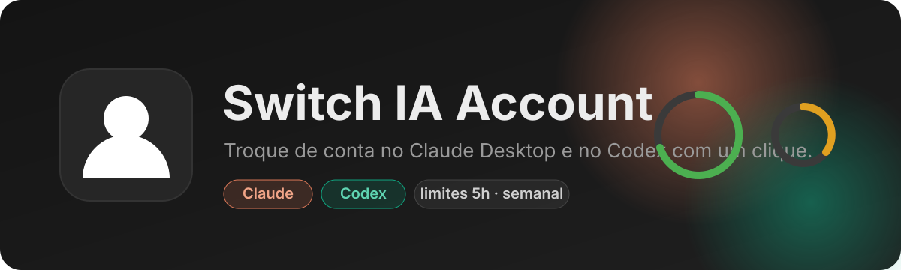

<p align="center">
  
</p>

<p align="center">
  <b>Troque de conta no Claude Desktop e no Codex com um clique, direto da bandeja do Windows.</b><br>
  Histórico de conversas mantido, limites de uso visíveis, um app aberto por vez.
</p>

<p align="center">
  
  
  
  
</p>

---

<p align="center">
  
  <br><sub>Contas fictícias. Metade esquerda: Claude Desktop. Metade direita: Codex.</sub>
</p>

## O que faz

- **Visual dark Liquid Glass** (estilo iOS 26): lente com refração nas bordas, aberração cromática, brilho especular direcional e tint escuro adaptativo, renderizado sobre o que está atrás da janela.
- **Um ícone na bandeja** (silhueta de pessoa). Clique e aparece um menu dividido em duas metades: **Claude** e **Codex**.
- **Troca com um clique.** Clique numa conta e o trocador fecha o app, troca o login e reabre na conta escolhida.
- **Histórico preservado.**
  - Codex: as conversas ficam em `~/.codex` e são as mesmas para todas as contas (igual à extensão do Codex no Cursor/VS Code).
  - Claude Desktop: as sessões da aba **Code** de todos os perfis apontam para a mesma pasta (junction), então você continua a conversa em qualquer conta.
- **Medidor de limite por conta**, no estilo do app original. Passe o mouse no anel:
  - normal: `Sessão (5h): X% restantes` e `Semanal: Y% restantes`;
  - sessão esgotada: quanto falta para o reset da sessão;
  - semanal esgotado: só quanto falta para renovar o semanal.
- **Adicionar conta** em cada metade:
  - Codex: abre o login no navegador (`codex login` numa pasta temporária) e guarda o resultado.
  - Claude: cria um perfil novo e abre o Claude nele para você logar.
- **Remover conta** pelo ícone de porta, com **dupla confirmação**: o 1º clique deixa a porta vermelha, o 2º abre a confirmação final.
- **Inicia com o Windows**, mesmo com o Claude e o Codex fechados.

## Instalação

Requisitos: Windows 10/11, [Python 3.10+](https://www.python.org/downloads/) no PATH, Claude Desktop e/ou Codex (app ou extensão do Cursor/VS Code).

```powershell
git clone https://github.com/LucasEngBr/switch-ia-account.git
cd switch-ia-account
powershell -ExecutionPolicy Bypass -File .\install.ps1
```

O instalador copia o app para `%LOCALAPPDATA%\SwitchIAAccount`, instala as dependências (`pystray`, `Pillow`, `cryptography`), cria atalhos no Menu Iniciar e na Inicialização e abre o ícone na bandeja.

Para remover: `powershell -ExecutionPolicy Bypass -File .\uninstall.ps1` (as contas salvas ficam até você apagar as pastas abaixo).

## Como funciona

<p align="center"></p>

### Codex

| Item | Detalhe |
|---|---|
| Login | O Codex guarda o login em `~/.codex/auth.json`. Cada conta tem uma cópia em `~/.codex-accounts/<account_id>/auth.json`. |
| Troca | Salva o `auth.json` atual (tokens renovados) no lugar dele, fecha o app do Codex e o `codex.exe` das extensões, coloca o `auth.json` da conta escolhida e reabre o app se ele estava aberto. No Cursor/VS Code, rode **Developer: Reload Window**. |
| Histórico | Não é tocado: `state_5.sqlite` e `thread_history_1.sqlite` em `~/.codex` servem todas as contas. |
| Limites | `GET chatgpt.com/backend-api/wham/usage` com o token da conta (o mesmo que o Codex usa). Contas inativas com token vencido são renovadas e salvas de volta na pasta delas. A conta ativa nunca é renovada pelo trocador. |

### Claude Desktop

| Item | Detalhe |
|---|---|
| Perfis | Cada conta é uma pasta de dados do Electron. Perfis já existentes na máquina são importados sozinhos; novos ficam em `~/.claude-accounts/profiles/`. |
| Troca | Fecha o Claude e reabre com `claude-desktop.exe --user-data-dir=<perfil>`. Só um aberto por vez. |
| Sessões do Code | A pasta `claude-code-sessions/<conta>/<org>` de cada perfil vira um junction para a pasta do primeiro perfil, com backup antes. Assim a barra lateral do Code mostra as mesmas sessões em todas as contas. Transcrições, skills e plugins já são compartilhados por `~/.claude`. |
| Limites | O login do perfil é lido do `config.json` (cache criptografado pelo Electron com DPAPI + AES-GCM, só para o seu usuário do Windows) e usado em `GET api.anthropic.com/api/oauth/usage`. O trocador não renova o login do Claude: se vencer, o anel mostra `!` até você abrir aquela conta uma vez. |
| Limitação | Conversas do chat comum (claude.ai) ficam na nuvem de cada conta e não são compartilhadas. |

### Arquivos

```
%LOCALAPPDATA%\SwitchIAAccount\   o app
~/.codex-accounts/                logins do Codex (auth.json por conta) + accounts.json
~/.claude-accounts/               profiles.json + perfis novos do Claude
```

## Segurança

- `~/.codex-accounts` guarda tokens do Codex **sem criptografia extra**, igual ao próprio `~/.codex/auth.json`. Não sincronize essa pasta (OneDrive, Dropbox) nem compartilhe.
- Os tokens do Claude continuam dentro dos perfis, criptografados pelo próprio app. O trocador só os lê localmente para consultar o uso.
- Nada é enviado para terceiros: as únicas chamadas de rede vão para `chatgpt.com`, `auth.openai.com` e `api.anthropic.com`, com o token da própria conta.

## Gerar as imagens

```powershell
python tools\render_demo.py
```

Renderiza o menu com contas fictícias em `docs/` e gera `src/icon.ico`.

## Aviso

Projeto pessoal, **não oficial**, sem vínculo com a Anthropic nem com a OpenAI. Usa formatos de arquivo e endpoints internos que podem mudar a qualquer atualização dos apps. Respeite os termos de uso de cada serviço: o trocador só alterna entre contas que são suas.

## Licença

[MIT](LICENSE)
